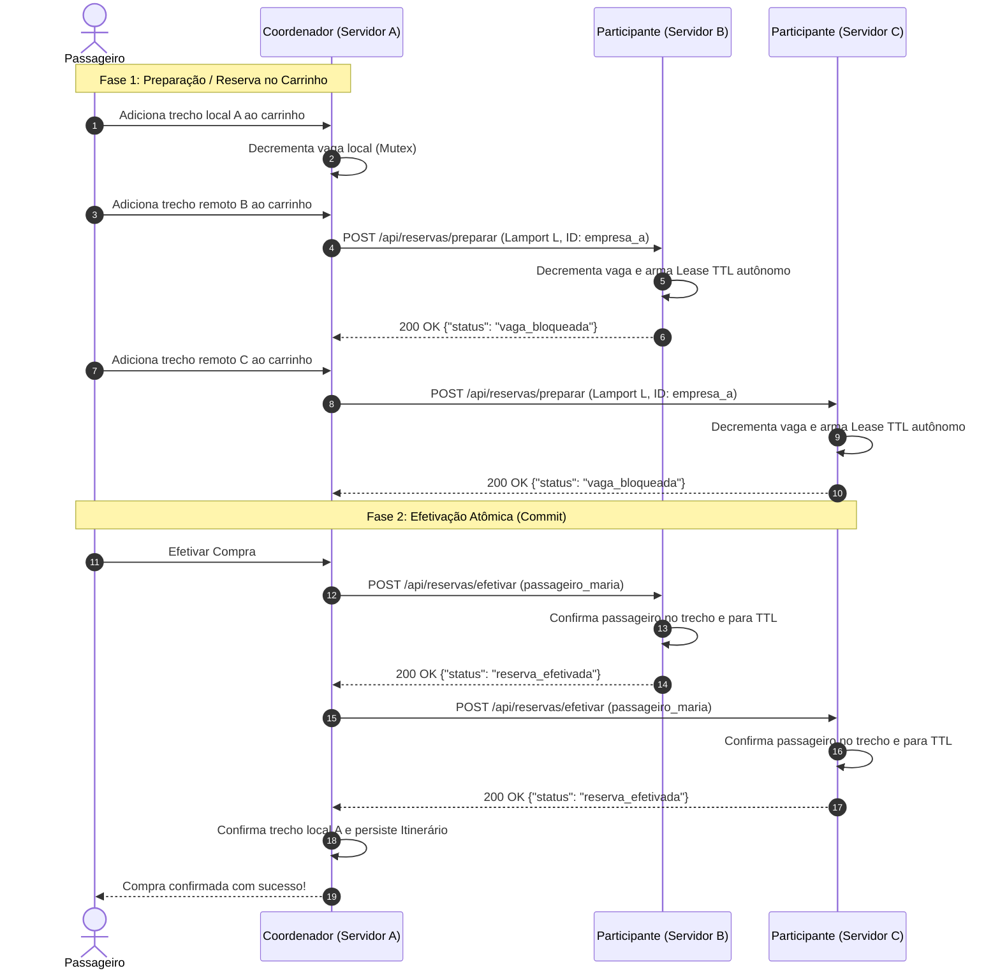

# VaiJunto: Sistema de Caronas Compartilhadas e Consórcio Distribuído

Protótipo distribuído de caronas de média e longa distância (TEC502, MI - Conectividade e Concorrência).
O sistema evoluiu do modelo centralizado (**Problema 1**) para um **Consórcio Distribuído Multi-Empresas** (**Problema 2**), onde diferentes empresas de transporte cooperam em rede federada para oferecer rotas interligadas, mantendo autonomia e consistência transacional.
Motoristas publicam rotas com paradas, e passageiros buscam e reservam assentos **por trecho**, inclusive combinando carros de motoristas de empresas diferentes.
A comunicação com os clientes usa **sockets TCP nativos** com mensagens **JSON**, enquanto a coordenação entre servidores parceiros usa **HTTP/REST**. Todo o controle de concorrência, consistência transacional (2PC) e ordenação causal (Lamport) é feito pelo próprio sistema, sem banco de dados.

- **Linguagem:** Go 1.26, só biblioteca padrão, sem frameworks externos.
- **Especificação do protocolo TCP (Clientes):** [`docs/PROTOCOLO.md`](docs/PROTOCOLO.md)
- **Especificação da API REST (Consórcio):** [`docs/API_REST.md`](docs/API_REST.md)

---

## Sumário
1. [Como executar](#1-como-executar)
2. [Arquitetura](#2-arquitetura)
3. [Modelo de dados](#3-modelo-de-dados)
4. [Comunicação e protocolo](#4-comunicação-e-protocolo)
5. [Busca de itinerários](#5-busca-de-itinerários)
6. [Concorrência](#6-concorrência)
7. [Atomicidade da reserva](#7-atomicidade-da-reserva)
8. [Confiabilidade](#8-confiabilidade)
9. [Clientes](#9-clientes)
10. [Testes](#10-testes)
11. [Docker e execução em máquinas distintas](#11-docker-e-execução-em-máquinas-distintas)
12. [Estrutura do projeto](#12-estrutura-do-projeto)
13. [Consórcio Distribuído Multi-Empresas (Problema 2)](#13-consórcio-distribuído-multi-empresas-problema-2)

---

## 1. Como executar

### Sem Docker (desenvolvimento)
Cada comando em um terminal. Os dados do servidor ficam na pasta de onde ele é executado.
```bash
cd cmd/servidor && go run .                 # servidor na porta 8081
go run ./cmd/cliente_motorista              # cliente motorista
go run ./cmd/cliente_passageiro             # cliente passageiro
```
Para usar outro servidor: `SERVER_URL=192.168.0.10:8081 go run ./cmd/cliente_passageiro`.

### Com Docker (uma máquina)
```bash
docker compose up --build -d servidor-empresa-a servidor-empresa-b servidor-empresa-c # sobe os 3 servidores do consórcio
docker compose run --rm motorista-1                  # cliente motorista (interativo)
docker compose run --rm passageiro-1                 # cliente passageiro (interativo)
docker compose logs -f                               # acompanhar os servidores
```

Para demonstrar a expiração do carrinho sem esperar 1 minuto, suba o servidor com um prazo menor. O log mostra o valor em uso (`Tempo de reserva do carrinho: 20s`).
```bash
VAIJUNTO_TEMPO_RESERVA=20s docker compose up -d servidor-empresa-a
```

### Variáveis de ambiente

| Variável | Onde | Padrão | Uso |
|---|---|---|---|
| `PORTA` | servidor | `8081` | porta TCP de atendimento aos clientes |
| `PORTA_REST` | servidor | `8082` | porta HTTP/REST da API do consórcio |
| `URL_EMPRESA` | servidor | `http://localhost:<PORTA_REST>` | URL base pública desta empresa no consórcio |
| `EMPRESAS_PARCEIRAS` | servidor | portas 8082, 9082, 10082 | lista de URLs das empresas parceiras separadas por vírgula |
| `ID_EMPRESA` | servidor | derivado da URL | identificador para o Relógio Lógico de Lamport |
| `VAIJUNTO_DADOS` | servidor | pasta atual | pasta onde são gravados os arquivos JSON (criada automaticamente) |
| `VAIJUNTO_TEMPO_RESERVA` | servidor | `1m` | tempo que as vagas ficam no carrinho, renovado a cada trecho adicionado (ex.: `20s`) |
| `TZ` | servidor | do sistema | fuso para comparar horários (no compose: `America/Bahia`) |
| `SERVER_URL` | clientes / teste | `localhost:8081` | endereço TCP do servidor ao qual o cliente se conecta |
| `IP_EXTERNO` | docker compose | — | `IP:porta` do servidor quando ele está em outra máquina |

---

## 2. Arquitetura

```
 ┌────────────────────┐        TCP / JSON por linha        ┌──────────────────────────────────────┐
 │ Cliente Motorista  │ ─────────────────────────────────▶ │           Servidor central           │
 │ (terminal)         │ ◀───────────────────────────────── │                                      │
 └────────────────────┘                                    │  goroutine por conexão (sessão)      │
 ┌────────────────────┐                                    │           │                          │
 │ Cliente Passageiro │ ─────────────────────────────────▶ │  internal/estado (regras + locks)    │
 │ (terminal)         │ ◀───────────────────────────────── │   Usuarios / Caronas / Itinerarios / │
 └────────────────────┘                                    │   CarrinhosPendentes  (sync.Map)     │
 ┌────────────────────┐                                    │           │                          │
 │ Teste de carga     │ ═══ centenas de conexões ════════▶ │  usuarios, caronas, itinerarios,     │
 └────────────────────┘                                    │  notificacoes .json (grav. atômica)  │
                                                           └──────────────────────────────────────┘
```

| Componente | Papel |
|---|---|
| **Servidor** (`cmd/servidor`) | Única fonte da verdade. Aceita conexões, mantém a sessão de cada uma, valida as mensagens e aplica as regras. |
| **Estado** (`internal/estado`) | Regras de negócio, estruturas em memória, travas, busca, carrinho, cancelamentos e persistência. |
| **Protocolo** (`internal/protocolo`) | Formato das mensagens, leitura com limite de tamanho, envio com prazo e códigos de status. |
| **Modelos** (`internal/modelos`) | Estruturas compartilhadas (carona, trecho, itinerário…) e constantes de negócio. |
| **Cliente motorista / passageiro** | Aplicativos de terminal. Não guardam estado de negócio; só mostram o que o servidor responde. |
| **Teste de carga** (`cmd/TesteCarga`) | Clientes simultâneos que verificam a corretude e medem o tempo de resposta. |


---

## 3. Modelo de dados

```
Carona (motorista)                        Itinerario (passageiro = a passagem)
 ├─ id, motorista_id                       ├─ id, passageiro_id
 ├─ origem → destino, data_hora            ├─ origem → destino, valor_total
 ├─ assentos  (capacidade do carro)        └─ trechos[]  ← cópias dos trechos comprados,
 └─ trechos[] ───────────────┐                            podem ser de caronas diferentes
                             ▼
             Trecho (unidade de venda)
              ├─ id, carona_id, motorista_id
              ├─ origem → destino, horario_saida, horario_chegada
              ├─ valor                      (preço por trecho)
              ├─ vagas_totais, vagas_livres (assentos DESTE trecho)
              └─ passageiros[]              (lista de embarque)
```

- **Rota:** sequência ordenada de cidades, representada pelos trechos encadeados da carona (A→B, B→C, …).
- **Assento:** controlado **por trecho**. Um assento ocupado em A→B continua livre em B→C.
  - O motorista informa a capacidade do carro e pode oferecer **menos vagas em um trecho específico** (de 1 até a capacidade).
- **Passageiro em várias cidades:** ele embarca e desembarca em qualquer par de cidades da rota, e cada trecho usado desconta uma vaga.
- **Carrinho:** estado temporário de uma compra em andamento. Guarda as cópias **oficiais** dos trechos já reservados e um prazo.
- **Datas:** `AAAA-MM-DD HH:MM` com dois dígitos, para que a ordem alfabética seja a ordem no tempo.

Mapas em memória (`internal/estado`):

| Mapa | Chave → Valor | Guarda |
|---|---|---|
| `Usuarios` | id → `Usuario` | cadastros |
| `Caronas` | id → `*RegistroCarona` (carona + **mutex próprio**) | Caronas postadas |
| `Itinerarios` | id → `Itinerario` | passagens confirmadas |
| `CarrinhosPendentes` | passageiro → `*RegistroCarrinho` (trechos + prazo + **mutex próprio**) | compras em andamento |
| `Notificacoes` | usuário → `*RegistroNotificacoes` (lista + **mutex próprio**) | central de notificações (`notificacoes.json`) |

---

## 4. Comunicação e protocolo

- **Sockets:** `net.Listen("tcp")` no servidor e `net.DialTimeout` nos clientes. `Accept` em laço, com **uma goroutine por conexão**.
- **Enquadramento:** uma mensagem JSON por linha (`\n`), com no máximo 64 KiB.
  - A leitura usa `bufio.Reader.ReadSlice` acumulando até o limite (`protocolo.LerMensagem`). Um cliente não consegue mandar uma "linha infinita".
- **Requisição:** `{"acao": ..., "payload": ...}`. **Resposta:** `{"status": ..., "mensagem": ..., "payload": ...}`.
- **Sessão:** o login fica associado à conexão. Toda ação usa o ID da sessão e **ignora IDs vindos no payload**. Cada ação exige um perfil (motorista ou passageiro).
- **Por que TCP:** reserva é uma operação que não pode se perder nem chegar fora de ordem. O TCP entrega de forma confiável e ordenada, e o fechamento da conexão (EOF/reset) avisa o servidor de que o cliente saiu.
- **Interoperabilidade:** JSON em UTF-8 é independente de linguagem e arquitetura. Um cliente em outra linguagem (Python, Java…) só precisa de um socket TCP e de um parser JSON.

Detalhes, campos de cada operação e exemplos reais: [`docs/PROTOCOLO.md`](docs/PROTOCOLO.md).

### Encapsulamento e validação
1. **JSON inválido:** a linha é recusada com `400`.
2. **Ação:** a ação precisa existir (`400`) e o perfil da sessão precisa ser o exigido (`401`/`403`).
3. **Payload:** fica cru (`json.RawMessage`) até a ação ser conhecida e só então é convertido para a struct esperada. Formato errado ou ausente dá `400`.
4. **Regras de negócio:** a camada de estado valida cidades, formato exato de datas, encadeamento de trechos, horários, valores, vagas, IDs e tipos. Cada erro volta com o status adequado (`400`/`403`/`404`/`409`) e uma mensagem legível.
5. **Falha inesperada:** um `recover` por requisição transforma um pânico em `500` **só naquela requisição**, e o servidor continua atendendo.

---

## 5. Busca de itinerários

`BUSCAR_ITINERARIOS` (`internal/estado/busca.go`):

1. **Foto do grafo.** Cada carona é travada rapidamente para copiar os trechos **com vaga** que ainda não partiram.
   - O grafo tem as cidades como vértices e cada trecho como aresta.
   - A busca em si roda sem nenhuma trava.
2. **BFS sobre caminhos.** A busca parte da origem, e cada estado da fila é um itinerário parcial. Um caminho só é estendido se:
   - o próximo trecho sai da cidade onde o anterior chega;
   - ele sai **depois** que o anterior chega;
   - a cidade de destino dele ainda não foi visitada.
   - Há também um limite de 6 trechos.
3. **Filtro de data.** O primeiro trecho sai na data pedida (`data`) ou a partir de um horário (`horario_minimo`, usado para continuar uma viagem).
4. **Combinação de motoristas.** Como a aresta é o trecho, trechos da mesma carona e de caronas diferentes se combinam naturalmente. Com isso, o passageiro embarca e desembarca em **qualquer par de cidades** da rota do motorista.
5. **Ordenação:** menos trocas de carro → chegada mais cedo → menor preço. São no máximo 30 opções.

No cliente, o passageiro monta a viagem **carro por carro**. O aplicativo agrupa os itinerários pelo primeiro carro e mostra, para cada opção, a melhor chegada possível até o destino. Assim, só aparecem escolhas que ainda chegam ao destino.

---

## 6. Concorrência

- **Uma goroutine por cliente.** Conexões lentas não atrasam as outras, e o runtime do Go multiplexa as goroutines sobre poucas threads do sistema, com I/O não bloqueante (netpoller).
- **Travas de granularidade fina.**
  - `sync.Map` para os índices: leituras concorrentes sem trava global.
  - Cada carona tem **seu próprio `sync.Mutex`** (`RegistroCarona`). Passageiros disputando carros diferentes não se bloqueiam.
  - Cada carrinho tem seu próprio mutex (`RegistroCarrinho`).
- **Cópias fora da trava.** Toda leitura que vira JSON é copiada (cópia profunda) **com a trava segura**, e a serialização acontece depois. Isso evita condições de corrida, verificadas com `go test -race`.
- **Persistência sem gargalo global.**
  - Cada arquivo JSON tem o próprio mutex, então arquivos diferentes são gravados em paralelo.
  - As gravações são **agrupadas**: quem espera e já teve a mudança incluída pela gravação anterior não grava de novo.
  - No teste de carga isso levou o cadastro de ~90 ms para ~12 ms em média.

---

## 7. Atomicidade da reserva

A compra tem duas etapas:

1. **Reserva (`ADICIONAR_CARRINHO`).** Ao escolher o carro de um trecho, a vaga é **descontada na hora**, sob o mutex daquela carona. Quem reserva primeiro fica com o assento.
   - Numa lista de trechos, se **qualquer** um falhar (vaga esgotada, carona cancelada, trecho que não encadeia), os que já foram descontados nessa requisição são devolvidos (*rollback*). A requisição não deixa nada pela metade.
   - Os trechos seguintes da viagem entram no **mesmo carrinho** (`continuacao=true`) e renovam o prazo.
2. **Confirmação (`EFETIVAR_ITINERARIO`).**
   - O carrinho é fechado de forma exclusiva: **ou** a confirmação **ou** o cronômetro de expiração vence, nunca os dois.
   - Em seguida, o servidor trava **todas** as caronas envolvidas **em ordem crescente de ID**, confere que nenhuma foi cancelada e, com todas travadas, inclui o passageiro em cada lista de embarque e grava o itinerário.
   - Se alguma carona foi cancelada, nada é gravado e as vagas dos outros trechos voltam.

**Deadlock:** não ocorre, por duas regras:
- **Uma trava por vez na reserva.** A reserva segura a trava de uma carona só, e a solta antes de pegar a próxima.
- **Ordem global nas demais operações.** Confirmação e cancelamentos travam várias caronas ao mesmo tempo, sempre em **ordem crescente de ID**. Assim, dois passageiros que usam as mesmas caronas em ordens diferentes pedem as travas na mesma sequência e nunca ficam esperando um pelo outro em ciclo.
- A gravação em disco acontece **depois** de soltar as travas das caronas.

**Quando o último trecho não está mais disponível:**
- A reserva desse trecho responde `409`, e as vagas dos trechos anteriores continuam no carrinho até o prazo acabar.
- Ao expirar, o servidor devolve tudo.
- Uma busca nova (`continuacao=false`) descarta o carrinho anterior na hora.

**Cancelamentos:**
- **Passageiro:** trava as caronas da viagem (em ordem), apaga o itinerário e devolve **todas** as vagas.
- **Motorista (cascata):**
  1. Marca a carona como cancelada; a partir daí nenhuma reserva ou confirmação a aceita.
  2. Remove a carona.
  3. Cancela cada itinerário afetado, devolvendo também as vagas nos carros dos outros motoristas.
- **Corrida entre cancelamentos:** o itinerário é removido com `LoadAndDelete` dentro das travas, então dois cancelamentos simultâneos nunca devolvem a mesma vaga duas vezes.

---

## 8. Confiabilidade

| Situação | Tratamento |
|---|---|
| Cliente fecha ou cai no meio de uma reserva | A goroutine termina ao receber EOF/erro. As vagas presas no carrinho voltam quando o prazo expira (cronômetro por carrinho). |
| Assentos bloqueados para sempre | Impossível: todo carrinho tem um cronômetro. Ao reiniciar, as vagas são **recalculadas** a partir das passagens confirmadas (`ReconciliarEstado`). |
| Servidor cai (kill -9) | Os JSON são gravados de forma **atômica** (arquivo `.tmp` + `rename`). Na subida, o servidor reconstrói listas de embarque e vagas e descarta itinerários órfãos. Se um arquivo não puder ser lido, o servidor não sobe (para não sobrescrever dados). |
| Mensagem malformada | Resposta `400`; a conexão continua. |
| Pânico ao processar uma requisição | `recover` responde `500` só para aquela requisição. |
| Mensagem gigante | Resposta `413`, e a conexão é fechada (não há como achar a próxima mensagem). |
| Cliente ocioso | Prazo de leitura de **30 min** (`SetReadDeadline`), renovado a cada mensagem. |
| Cliente que não lê respostas | Prazo de escrita de **10 s** (`SetWriteDeadline`). |
| Servidor lento ou fora do ar (visto pelo cliente) | 5 s para conectar e 15 s por resposta. O cliente mostra "Conexão com o servidor perdida" e encerra. |
| Motorista cancela durante uma compra | A confirmação detecta a carona cancelada, não grava nada e devolve as vagas dos outros trechos. |

---

## 9. Clientes

### Motorista
1. **Cadastrar / Login**
2. **Publicar carona**
   - O motorista informa origem, destino, data e hora, e a capacidade do carro.
   - Com paradas, informa **trecho a trecho**: cidade, valor, **vagas oferecidas no trecho** (Enter = capacidade), chegada e a saída do próximo.
   - As entradas inválidas são pedidas de novo (cidade não atendida, data fora do formato, número fora da faixa).
3. **Consultar passageiros confirmados:** cada carona com seus trechos, vagas livres/totais e os IDs dos passageiros de **cada trecho**.
4. **Cancelar carona:** lista, escolha e confirmação. Avisa que as viagens dos passageiros serão canceladas em cascata.
5. **Central de notificações `[x]`:** avisos de passageiros que confirmaram ou cancelaram uma vaga, ou que saíram da carona porque outra carona da mesma viagem foi cancelada.

### Passageiro
1. **Buscar itinerários**
   - O passageiro informa origem, destino e data, e o servidor devolve os itinerários possíveis.
   - Ele escolhe **o carro de cada pedaço da viagem**, e a vaga é reservada na hora.
   - Cada opção mostra o horário, o preço e a melhor chegada até o destino.
2. **Abrir carrinho:** mostra os trechos reservados e o total, e pede a confirmação da compra.
3. **Consultar minhas viagens:** passagens confirmadas, com o motorista de cada trecho.
4. **Cancelar viagem:** cancela a viagem inteira e devolve as vagas.
5. **Central de notificações `[x]`:** avisos de viagem cancelada pelo motorista e de reserva expirada.

### Central de notificações
- **Sem pop-ups.** O menu mostra `Central de notificações [x]`, onde `x` é quantos avisos chegaram desde a última abertura (`CONTAR_NOTIFICACOES`, pedido a cada vez que o menu aparece).
- **Abrir zera o contador.** Ao abrir (`ABRIR_NOTIFICACOES`), aparecem os avisos mais novos primeiro, com 🆕 nos que ainda não tinham sido vistos, e o contador volta a zero.
- **Protocolo inalterado.** O servidor só guarda os avisos; quem pergunta é o cliente. Isso mantém o modelo requisição e resposta, sem mensagens enviadas pelo servidor por conta própria.
- **Concorrência.** Cada usuário tem sua lista com mutex próprio. O aviso é criado com as travas de carona seguras (a trava da lista nunca espera por outra), e a gravação em disco acontece depois de soltá-las.
- **Limite.** Até 50 avisos por usuário, gravados em `notificacoes.json` e mantidos após reinícios.

---

## 10. Testes

### Testes automatizados (unitários, distribuídos e de concorrência)
```bash
go test -race ./...
```
- **`internal/estado/estado_test.go`:**
  - baldeação, cancelamento e cascata;
  - carona cancelada durante a compra e disputa entre confirmação e expiração;
  - expiração e renovação do carrinho, e nova busca descartando o carrinho anterior;
  - preço oficial (payload adulterado) e trechos não encadeados;
  - validações, busca (data, conexões, pares da rota, ordenação), vagas diferentes por trecho;
  - reconciliação após queda e gravação concorrente;
  - central de notificações (quem é avisado em cada evento, contador que zera ao abrir, limite e gravação);
  - um **teste de estresse** com compras, cancelamentos e cascatas simultâneos que confere as invariantes.
- **`internal/consorcio/consorcio_test.go`:**
  - comunicação HTTP/REST entre servidores do consórcio;
  - *Scatter-Gather* com filtro de datas;
  - Fase 1 (Prepare) e Rollback (Cancel);
  - Fase 2 (Commit/Efetivar) com inclusão do passageiro no manifesto e notificação do motorista parceiro.
- **`internal/estado/busca_distribuida_test.go`:**
  - *Scatter-Gather* concorrente e união no grafo BFS;
  - rota multi-empresa combinando 3 servidores distintos (A ➔ B ➔ C);
  - reserva interativa no carrinho preservando vagas locais e remotas.
- **`internal/estado/concorrencia_falhas_test.go`:**
  - injeção de falhas e queda de servidor durante o *Prepare* e durante o *Commit* do 2PC;
  - abort atômico e rollback de vagas com aviso ao passageiro;
  - concorrência extrema com 50 requisições simultâneas disputando a última vaga e preempção por Relógio Lógico de Lamport;
  - recuperação autônoma de assentos por *Lease TTL* em background;
  - cancelamento em cascata distribuído provocado por motorista parceiro.
- **`cmd/servidor/mainServer_test.go`** (via `net.Pipe`): mensagens malformadas, sessão e perfis, IDs do payload ignorados, mensagem acima do limite e central de notificações.

### Teste de carga (múltiplos clientes TCP simultâneos)
> ⚠️ O teste cria usuários e caronas de verdade: rode contra um **servidor de testes**.

```bash
# servidor de testes com dados descartáveis e reserva curta
mkdir -p /tmp/vaijunto-teste
cd cmd/servidor && VAIJUNTO_DADOS=/tmp/vaijunto-teste VAIJUNTO_TEMPO_RESERVA=5s go run .

# em outro terminal
go run ./cmd/TesteCarga -servidor localhost:8081 -passageiros 300 -vagas 5 -espera 7s
```

| Opção | Padrão | Descrição |
|---|---|---|
| `-servidor` | `$SERVER_URL` ou `localhost:8081` | servidor alvo |
| `-passageiros` | 200 | passageiros simultâneos |
| `-vagas` | 5 | vagas por trecho nas caronas do teste |
| `-cancelar` | true | um motorista cancela a carona no meio da disputa |
| `-espera` | 65s | espera para os carrinhos abandonados expirarem antes da última verificação (use um valor maior que o `VAIJUNTO_TEMPO_RESERVA` do servidor) |

O que o teste faz:
1. **Fase 1:** 100 conexões cadastram o **mesmo** ID ao mesmo tempo. Exatamente 1 cadastro pode ser aceito.
2. **Fase 2:** três motoristas publicam caronas que se cruzam (direta com parada, e duas que se combinam), gerando 3 itinerários possíveis de Feira de Santana a Aracaju.
3. **Fase 3:** N passageiros ficam prontos e **largam juntos**. Cada um busca, escolhe um itinerário ao acaso, reserva carro por carro e confirma. No meio da disputa, um motorista cancela a carona.
4. **Fase 4:** a verificação é feita só pelo protocolo e confere que:
   - nenhum itinerário ficou pela metade;
   - cada itinerário tem os trechos escolhidos;
   - nenhuma compra que falhou gerou passagem;
   - nenhuma passagem sumiu sem motivo;
   - nenhum itinerário usa a carona cancelada;
   - **nenhum assento foi vendido duas vezes**;
   - as listas de embarque batem com as passagens;
   - depois do prazo, **nenhum assento ficou bloqueado**.
5. **Relatório:** tempo de resposta por operação (média, p50, p95, p99, máximo). O programa sai com código 1 se alguma verificação falhar.

Resultado de referência: 300 passageiros e 5 vagas por trecho, com servidor e teste na mesma máquina (notebook Linux).

| Operação | Qtd | Média | P95 | P99 |
|---|---|---|---|---|
| ADICIONAR_CARRINHO | 193 | 3,96 ms | 9,15 ms | 11,87 ms |
| BUSCAR_ITINERARIOS | 300 | 11,58 ms | 16,86 ms | 18,09 ms |
| CADASTRAR | 403 | 11,83 ms | 24,26 ms | 25,40 ms |
| EFETIVAR_ITINERARIO | 10 | 7,21 ms | 11,53 ms | 11,53 ms |
| LOGIN | 303 | 2,03 ms | 10,21 ms | 14,42 ms |
| **Todas** | 1519 | 6,41 ms | 19,35 ms | 24,61 ms |

Todas as verificações passaram, sem falhas de rede. Nessa execução, os dois trechos que sobraram terminaram com 5/5 assentos vendidos, e 3 passagens foram canceladas em cascata pelo motorista que desistiu.

### Pelo Docker
```bash
docker compose --profile teste run --rm teste-carga -passageiros 300 -espera 70s
# -espera precisa ser maior que o VAIJUNTO_TEMPO_RESERVA do servidor (padrão 1m)
# contra um servidor em outra máquina:
IP_EXTERNO=192.168.0.10:8081 docker compose --profile teste run --rm --no-deps teste-carga
```

---

## 11. Docker e execução em máquinas distintas

Cada componente tem sua imagem (`Dockerfile.servidor`, `Dockerfile.motorista`, `Dockerfile.passageiro`, `Dockerfile.teste`). Todas usam build em dois estágios: compilação em `golang:1.26-alpine` e execução em imagem enxuta `alpine`.

### 11.1. Execução em uma única máquina (Single-host)

Neste modo, os três servidores do consórcio rodam juntos na mesma máquina física e se comunicam através da rede interna do Docker Compose:

1. **Subir os 3 servidores do consórcio:**
   ```bash
   docker compose up --build -d servidor-empresa-a servidor-empresa-b servidor-empresa-c
   ```
   - O Compose publica as portas de cada empresa no host:
     - **Empresa A:** TCP `8081` (clientes) / REST `8082` (consórcio)
     - **Empresa B:** TCP `9081` (clientes) / REST `9082` (consórcio)
     - **Empresa C:** TCP `10081` (clientes) / REST `10082` (consórcio)
   - Os dados persistentes de cada empresa ficam mapeados nos volumes `./cmd/servidor/dados_a`, `dados_b` e `dados_c`.

2. **Executar clientes interativos na mesma máquina:**
   - Conectar à **Empresa A** (porta 8081 - padrão):
     ```bash
     docker compose run --rm motorista-1
     docker compose run --rm passageiro-1
     ```
   - Conectar à **Empresa B** (porta 9081) ou **Empresa C** (porta 10081):
     ```bash
     IP_EXTERNO=servidor-empresa-b:9081 docker compose run --rm passageiro-1
     IP_EXTERNO=servidor-empresa-c:10081 docker compose run --rm passageiro-1
     ```

3. **Acompanhar logs:**
   ```bash
   docker compose logs -f
   ```

---

### 11.2. Execução em máquinas distintas (Multi-host / Laboratório)

Para demonstrações no laboratório ou testes distribuídos reais, há dois cenários possíveis:

#### Cenário A: Servidores em uma máquina e Clientes em outras máquinas

Ideal para quando um computador hospeda os servidores do consórcio e outros computadores (ou notebooks) rodam os clientes:

1. **Na máquina dos servidores (ex.: IP `192.168.1.100`):**
   ```bash
   docker compose up --build -d servidor-empresa-a servidor-empresa-b servidor-empresa-c
   ```
   - Certifique-se de que as portas TCP (`8081`, `9081`, `10081`) e REST (`8082`, `9082`, `10082`) estão liberadas no firewall da máquina servidora.

2. **Nas máquinas dos clientes:**
   O cliente usa o IP real da máquina servidora através da variável `IP_EXTERNO`:
   ```bash
   # Cliente passageiro na Empresa A:
   IP_EXTERNO=192.168.1.100:8081 docker compose run --rm --no-deps passageiro-1

   # Cliente motorista na Empresa B:
   IP_EXTERNO=192.168.1.100:9081 docker compose run --rm --no-deps motorista-1

   # Cliente passageiro na Empresa C:
   IP_EXTERNO=192.168.1.100:10081 docker compose run --rm --no-deps passageiro-1
   ```
   - A flag `--no-deps` evita que o Docker tente inicializar o contêiner do servidor localmente na máquina do cliente.
   - Caso a máquina do cliente possua Go instalado, também pode rodar diretamente sem Docker:
     ```bash
     SERVER_URL=192.168.1.100:8081 go run ./cmd/cliente_passageiro
     ```

#### Cenário B: Servidores distribuídos entre máquinas distintas (Cada máquina roda uma Empresa)

Este é o teste mais realista do Consórcio Distribuído: cada empresa opera em um computador ou servidor físico diferente.

Exemplo de topologia:
- **Máquina 1 (Empresa A):** IP `192.168.1.10`
- **Máquina 2 (Empresa B):** IP `192.168.1.20`
- **Máquina 3 (Empresa C):** IP `192.168.1.30`

Como os servidores estão em hosts diferentes, o endereço interno do Docker não é resolvido entre máquinas distintas. Informamos os IPs reais dos parceiros via variáveis de ambiente:

1. **Na Máquina 1 (Empresa A):**
   ```bash
   URL_EMPRESA_A=http://192.168.1.10:8082 \
   EMPRESAS_PARCEIRAS_A=http://192.168.1.20:9082,http://192.168.1.30:10082 \
   docker compose up --build -d servidor-empresa-a
   ```

2. **Na Máquina 2 (Empresa B):**
   ```bash
   URL_EMPRESA_B=http://192.168.1.20:9082 \
   EMPRESAS_PARCEIRAS_B=http://192.168.1.10:8082,http://192.168.1.30:10082 \
   docker compose up --build -d servidor-empresa-b
   ```

3. **Na Máquina 3 (Empresa C):**
   ```bash
   URL_EMPRESA_C=http://192.168.1.30:10082 \
   EMPRESAS_PARCEIRAS_C=http://192.168.1.10:8082,http://192.168.1.20:9082 \
   docker compose up --build -d servidor-empresa-c
   ```

4. **Conectar clientes em qualquer máquina da rede:**
   ```bash
   # Para acessar a Empresa A (na Máquina 1):
   IP_EXTERNO=192.168.1.10:8081 docker compose run --rm --no-deps passageiro-1

   # Para acessar a Empresa B (na Máquina 2):
   IP_EXTERNO=192.168.1.20:9081 docker compose run --rm --no-deps motorista-1
   ```

**Vantagens do uso do Docker:**
- Garante o mesmo ambiente e dependências em qualquer máquina do laboratório;
- Isolamento total dos dados de cada empresa;
- Facilidade para simular quedas de nós individuais (`docker compose stop servidor-empresa-c`) e verificar a tolerância a falhas do 2PC e do cancelamento em cascata.

---

## 12. Estrutura do projeto

```
VaiJunto/
├── cmd/
│   ├── servidor/            # servidor TCP/JSON + REST (+ testes de protocolo) e dados JSON
│   ├── cliente_motorista/   # aplicativo do motorista (terminal TCP)
│   ├── cliente_passageiro/  # aplicativo do passageiro (terminal TCP)
│   ├── TesteCarga/          # teste de carga e corretude com 300+ clientes
│   └── simular_consorcio/   # utilitário CLI para testar chamadas REST do consórcio
├── internal/
│   ├── consorcio/           # API REST, cliente HTTP, Relógios de Lamport (+ testes)
│   ├── estado/              # regras, BFS, 2PC, travas, notificações, persistência (+ testes)
│   ├── protocolo/           # mensagens TCP/JSON, leitura/escrita com limites e prazos
│   ├── modelos/             # estruturas compartilhadas (Carona, Trecho, Itinerario)
│   └── cli/                 # interface de texto dos clientes e comunicação com servidor
├── docs/
│   ├── PROTOCOLO.md         # especificação técnica do protocolo TCP cliente-servidor
│   └── API_REST.md          # especificação técnica da API REST entre empresas do consórcio
├── docker-compose.yaml      # emulação multi-empresa (3 servidores: Empresa A, B e C)
└── Dockerfile.{servidor,motorista,passageiro,teste}
```

---

## 13. Consórcio Distribuído Multi-Empresas (Problema 2)

O **Problema 2** expande o sistema de caronas centralizado para um **ambiente distribuído federado**, simulando um consórcio entre diferentes empresas de transporte rodoviário. Cada empresa opera seu próprio servidor autônomo com sua base de motoristas e caronas, mas colabora em rede para montar itinerários integrados entre cidades atendidas por empresas distintas.

```
                           ┌────────────────────────┐
                           │      Empresa A         │
                           │ TCP: 8081 / REST: 8082 │
                           └───────────┬────────────┘
                                       │
                    HTTP/REST          │           HTTP/REST
           ┌───────────────────────────┴───────────────────────────┐
           ▼                                                       ▼
┌────────────────────────┐                               ┌────────────────────────┐
│      Empresa B         │ ◀───────────────────────────▶ │      Empresa C         │
│ TCP: 9081 / REST: 9082 │           HTTP/REST           │ TCP: 10081 /REST: 10082│
└────────────────────────┘                               └────────────────────────┘
```

---

### 13.1. Arquitetura Híbrida de Comunicação

Adotou-se uma arquitetura em camadas clara e bem delimitada:

1. **Clientes $\leftrightarrow$ Servidor da sua Empresa:** Comunicação via **Sockets TCP** com mensagens JSON por linha (`\n`). Preserva a sessão autenticada do motorista/passageiro e o baixo overhead.
2. **Servidores de Empresas Diferentes $\leftrightarrow$ Servidores Parceiros:** Comunicação via **HTTP/REST** utilizando payloads JSON (`application/json`).
   - Garante **interoperabilidade** e **desacoplamento**: cada servidor expõe endpoints bem definidos para consulta, pré-reserva e efetivação de trechos.
   - Todo endpoint possui tratamento de **idempotência** e **timeouts explícitos** (padrão de 5 segundos) para evitar travamento em caso de lentidão ou queda do parceiro.

Especificação detalhada das rotas e payloads: [`docs/API_REST.md`](docs/API_REST.md).

---

### 13.2. Descoberta Distribuída de Rotas (Scatter-Gather + Grafo BFS)

Quando um passageiro solicita um trajeto que cruza regiões atendidas por mais de uma empresa (ex.: *Feira de Santana $\rightarrow$ Montes Claros* ou *Feira de Santana $\rightarrow$ Minas*), o servidor de origem executa o padrão **Scatter-Gather**:

```
                             Passageiro busca: Feira de Santana ➔ Minas
                                                 │
                                                 ▼
                                        ┌─────────────────┐
                                        │   Servidor A    │
                                        └────────┬────────┘
                                                 │
                   ┌─────────────────────────────┼─────────────────────────────┐
                   │ (concorrente)               │ (concorrente)               │ (local)
                   ▼                             ▼                             ▼
         GET /api/trechos/disponiveis  GET /api/trechos/disponiveis     Consulta sync.Map
             (Servidor B: 9082)            (Servidor C: 10082)           (Caronas locais)
                   │                             │                             │
                   └─────────────────────────────┼─────────────────────────────┘
                                                 │
                                                 ▼
                                    União dos trechos no Grafo BFS
                                                 │
                                                 ▼
                     Itinerário montado: FSA ➔ VDC (A) + VDC ➔ MOC (B) + MOC ➔ MINAS (C)
```

1. **Consulta Concorrente (*Scatter*):** O servidor de origem dispara goroutines paralelas para cada empresa parceira cadastrada em `EmpresasParceiras`, consultando `GET /api/trechos/disponiveis?data_inicio=D&data_fim=D+1`.
2. **Janela de Busca ($T$ a $T+1$ dia):** Conforme os requisitos do consórcio, os servidores retornam trechos com saída entre a data solicitada pelo passageiro até $+1$ dia adicional, permitindo que conexões com viagens noturnas ou que cheguem na madrugada seguinte sejam descobertas.
3. **Agregação e Busca em Grafo (*Gather* + BFS):** Os trechos recebidos dos parceiros recebem a etiqueta de sua empresa de origem (`t.URL_Empresa`) e são integrados ao grafo de cidades em memória do servidor local. O algoritmo BFS encontra todos os caminhos válidos respeitando encadeamento de horários e cidades.

---

### 13.3. Transações Distribuídas com Two-Phase Commit (2PC)

A reserva e confirmação de um itinerário que envolve trechos de múltiplas empresas constitui uma transação distribuída que **não pode ficar pela metade** (Princípio ACID / Atomicidade). O consórcio utiliza o protocolo **Two-Phase Commit (2PC)**:



#### Tratamento de Falhas e Abort Atômico (Rollback):
Se qualquer participante falhar, cair ou retornar timeout durante a compra:
- **Falha no Prepare:** O coordenador aborta a operação, devolve as vagas locais já seguradas e informa o passageiro.
- **Queda durante o Commit:** Se o Servidor C cair antes de receber o Commit, o Servidor A detecta o erro de rede, **cancela imediatamente** os trechos já confirmados nos outros parceiros (`POST /api/reservas/cancelar`), devolve as vagas locais ao estoque do motorista, não emite nenhum itinerário e avisa o passageiro.

---

### 13.4. Relógios Lógicos de Lamport e Ordenação Causal

Em cenários de concorrência extrema onde duas ou mais requisições de diferentes empresas disputam a **mesma última vaga** de uma carona parceira, a decisão não pode depender da latência da rede física (jitter ou atraso de pacotes TCP).

Para isso, foi implementado o algoritmo de **Relógios Lógicos de Lamport** ([`internal/consorcio/relogio.go`](internal/consorcio/relogio.go)):

1. **Avanço Causal:**
   - Antes de enviar uma requisição `POST /api/reservas/preparar`, o servidor de origem executa `Tick()`: $L = L + 1$.
   - O servidor parceiro que recebe a requisição executa `Atualizar(recebido)`: $L = \max(L_{\text{local}}, L_{\text{recebido}}) + 1$.
2. **Critério de Desempate e Preempção Determinística:**
   - O servidor que gerencia o assento avalia a tupla de ordem total $(L, \text{ID}_{\text{empresa}})$.
   - Se uma vaga estiver pré-bloqueada no carrinho de um passageiro e chegar outra requisição concorrente disputando aquele último assento:
     $$(L_{\text{novo}} < L_{\text{anterior}}) \lor (L_{\text{novo}} == L_{\text{anterior}} \land \text{ID}_{\text{novo}} < \text{ID}_{\text{anterior}})$$
   - Quem emitiu a requisição primeiro no **tempo lógico causal** ganha a vaga, ocorrendo a preempção determinística e justa da vaga anterior.

---

### 13.5. Tolerância a Falhas e Recuperação de Estado

| Falha Simulada | Mecanismo de Recuperação | Comportamento do Sistema |
|---|---|---|
| **Abandono de Carrinho** | *Lease / Soft-State* com TTL | O servidor parceiro arma um timer autônomo (`TempoReservaCarrinho + 15s`). Se o coordenador não efetivar nem cancelar, o parceiro libera o assento automaticamente. |
| **Queda do Servidor Parceiro (Commit)** | 2PC Abort & Rollback | O coordenador detecta a queda do parceiro, cancela trechos confirmados nas outras empresas, devolve vagas locais e notifica o usuário. |
| **Queda Repentina (`kill -9`)** | Gravação Atômica e Reconciliação | Ao reiniciar, o servidor lê os arquivos JSON e recalcula as vagas a partir das passagens efetivamente salvas (`ReconciliarEstado`). |
| **Retentativa de Rede / Mensagem Duplicada** | Idempotência Transacional | Chamadas repetidas de `preparar`, `efetivar` ou `cancelar` reconhecem o mesmo `(carona_id, trecho_id, passageiro_id)` e respondem com sucesso sem descontar vagas duplicadas. |

---

### 13.6. Cancelamento em Cascata e Notificações no Consórcio

1. **Cancelamento pelo Motorista Parceiro:**
   - Se um motorista na Empresa B cancela sua carona, o Servidor B dispara `POST /api/caronas/cancelada` para todas as empresas parceiras.
   - O Servidor A localiza todas as viagens locais de passageiros que continham aquele trecho, cancela os itinerários, restaura as vagas dos motoristas locais da Empresa A e notifica passageiros e motoristas.
2. **Cancelamento pelo Passageiro:**
   - Quando o passageiro cancela sua viagem no Servidor A, o cancelador despacha `POST /api/reservas/cancelar` com o `PassageiroID` para cada empresa remota.
   - O parceiro devolve o número da vaga ao estoque, remove o passageiro do manifesto do motorista e adiciona o alerta na **Central de Notificações** do motorista parceiro (`[1]`).

---

### 13.7. Execução do Consórcio

#### Opção A: Via Docker Compose (3 Servidores Isolados)
O arquivo [`docker-compose.yaml`](docker-compose.yaml) sobe o consórcio completo com três empresas:
```bash
# Inicia as 3 empresas em segundo plano
docker compose up -d servidor-empresa-a servidor-empresa-b servidor-empresa-c

# Visualiza os logs unificados de comunicação REST e TCP
docker compose logs -f

# Encerra os serviços
docker compose down
```

#### Opção B: Localmente no Terminal (Sem Docker)
Graças ao auto-reconhecimento de diretórios e portas padrão, basta abrir três abas de terminal:

```bash
# Terminal 1 — Empresa A (TCP 8081 / REST 8082)
env PORTA=8081 PORTA_REST=8082 VAIJUNTO_DADOS=/tmp/srv_a ID_EMPRESA=empresa_a go run ./cmd/servidor

# Terminal 2 — Empresa B (TCP 9081 / REST 9082)
env PORTA=9081 PORTA_REST=9082 VAIJUNTO_DADOS=/tmp/srv_b ID_EMPRESA=empresa_b go run ./cmd/servidor

# Terminal 3 — Empresa C (TCP 10081 / REST 10082)
env PORTA=10081 PORTA_REST=10082 VAIJUNTO_DADOS=/tmp/srv_c ID_EMPRESA=empresa_c go run ./cmd/servidor
```

---

### 13.8. Roteiro Passo a Passo para Demonstração do Barema

| Etapa | Ação | Resultado Esperado |
|---|---|---|
| **1. Publicação Multi-Empresa** | Motorista publica em A (`FSA ➔ VDC`), em B (`VDC ➔ MOC`) e em C (`MOC ➔ Minas`). | As 3 empresas armazenam seus respectivos trechos em suas bases locais. |
| **2. Scatter-Gather e BFS** | Passageiro no Servidor A busca `Feira de Santana ➔ Minas`. | O Servidor A consulta B e C via REST e monta a rota integrada de 3 baldeações. |
| **3. Bloqueio no Carrinho** | Passageiro adiciona a rota no carrinho. | Servidor A envia *Prepare (2PC)* para B e C; as vagas de B e C diminuem de imediato no estoque. |
| **4. Efetivação Atômica** | Passageiro confirma a compra. | Servidor A envia *Commit (2PC)*; os manifestos dos motoristas de A, B e C recebem o passageiro e os alertas são emitidos. |
| **5. Injeção de Queda** | Derruba o Servidor C (`Ctrl+C`) e tenta comprar trecho que dependa de C. | O Servidor A detecta a indisponibilidade, cancela a compra, devolve as vagas locais e avisa o passageiro. |
| **6. Cancelamento em Cascata** | Motorista de B cancela sua carona. | Servidor B avisa o Servidor A (`/api/caronas/cancelada`), o itinerário do passageiro é desfeito e a vaga de A é restaurada. |
| **7. Cancelamento pelo Passageiro** | Passageiro cancela seu bilhete em A. | A vaga do Servidor B e C é restaurada e os motoristas recebem notificação no menu (`[1]`). |
