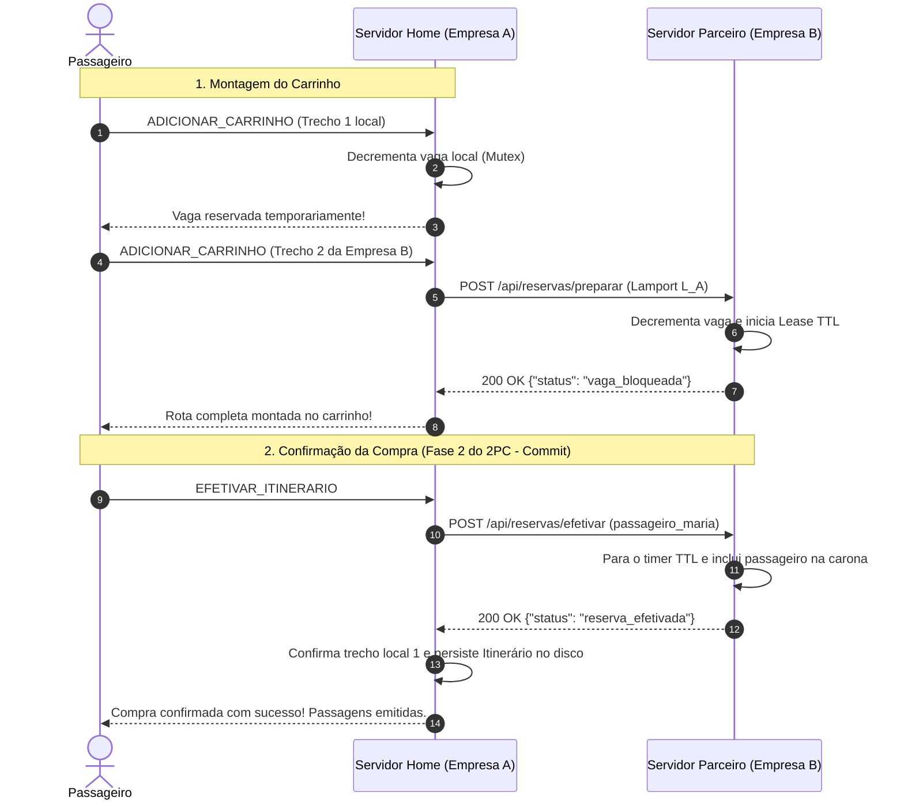
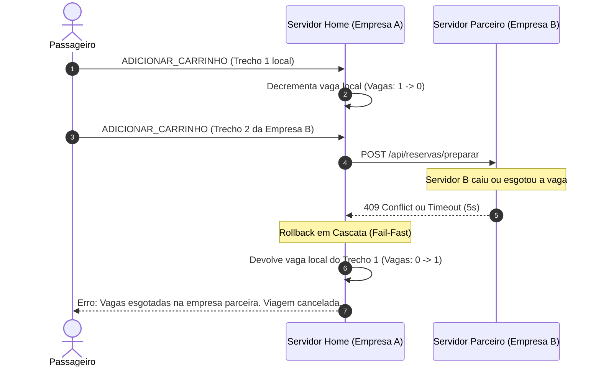

# Especificação da API REST do Consórcio VaiJunto

Esta documentação atende aos requisitos do **Problema 2** e ao **Item 2 do Barema de Avaliação**, especificando as rotas HTTP/REST utilizadas para a comunicação e coordenação distribuída entre os servidores das empresas parceiras do consórcio.

---

## 1. Visão Geral da Arquitetura de Comunicação

* **Clientes (Passageiros e Motoristas) $\leftrightarrow$ Servidor Home:** Comunicação via **TCP** com mensagens JSON delimitadas por `\n`.
* **Servidores de Empresas Diferentes $\leftrightarrow$ Servidores Parceiros:** Comunicação via **HTTP/REST** utilizando formato JSON (`application/json`).
* **Timeout Padrão de Rede:** $5$ segundos para qualquer chamada HTTP entre servidores.
* **Idempotência:** Requisições repetidas (re-tentativas por timeout ou instabilidade de rede) são tratadas de forma idempotente, sem descontar vagas duplicadas ou gerar estados inconsistentes.

---

## 2. Endpoints e Recursos

### 2.1. `GET /api/trechos/disponiveis` (Scatter-Gather)
Recurso utilizado para consulta de viagens disponíveis em tempo real.

* **Método:** `GET`
* **Parâmetros de Consulta (Query Params):**
  * `data_inicio` (opcional): Data inicial de partida no formato `AAAA-MM-DD`.
  * `data_fim` (opcional): Data limite de partida no formato `AAAA-MM-DD` (padrão do consórcio: até $+1$ dia em relação à data solicitada pelo passageiro).
* **Códigos de Retorno:**
  * `200 OK`: Retorna array com os trechos que possuem vagas livres (`vagas_livres > 0`) e horário futuro.
  * `405 Method Not Allowed`: Se invocado com método diferente de `GET`.
* **Exemplo de Resposta (`200 OK`):**
```json
[
  {
    "id": "trecho_101",
    "carona_id": "carona_50",
    "motorista_id": "mot_carlos",
    "origem": "Vitória da Conquista",
    "destino": "Montes Claros",
    "valor": 75.0,
    "vagas_totais": 3,
    "vagas_livres": 2,
    "horario_saida": "2026-11-02 16:00",
    "horario_chegada": "2026-11-03 08:00",
    "url_empresa": "http://servidor-empresa-b:9082"
  }
]
```

---

### 2.2. `POST /api/reservas/preparar` (Fase 1 do 2PC / Carrinho Distribuído)
Bloqueia temporariamente uma vaga em um trecho de carona da empresa parceira.

* **Método:** `POST`
* **Corpo da Requisição (JSON):**
```json
{
  "carona_id": "carona_50",
  "trecho_id": "trecho_101",
  "relogio_logico": 14,
  "id_origem": "empresa_a"
}
```
* **Códigos de Retorno:**
  * `200 OK`: Vaga bloqueada temporariamente com sucesso (`{"status": "vaga_bloqueada"}`).
  * `409 Conflict`: Vagas esgotadas, carona cancelada ou partida já ocorrida (`{"erro": "vaga_esgotada_ou_invalida"}`).
  * `400 Bad Request`: JSON malformado ou campos obrigatórios ausentes.
* **Comportamento e Idempotência:**
  * Se a mesma requisição (mesmo `id_origem` e `relogio_logico`) for reenviada, o servidor reconhece a duplicidade e retorna `200 OK`, renovando o prazo sem subtrair outra vaga.
  * **Preempção por Relógio de Lamport (Item 6):** Se duas requisições disputarem a última vaga disponível, o servidor compara a tupla `(relogio_logico, id_origem)`. A requisição com menor relógio lógico ganha a vaga.
  * **TTL / Lease Autônomo (Item 8):** Ao preparar a vaga, o servidor parceiro inicia um timer autônomo (`TempoReservaCarrinho + 15s`). Se o servidor cliente cair e nunca mandar commit nem cancel, o parceiro libera a vaga automaticamente.

---

### 2.3. `POST /api/reservas/efetivar` (Fase 2 do 2PC - Commit Definitivo)
Confirma a reserva e insere definitivamente o passageiro na lista de embarque do motorista.

* **Método:** `POST`
* **Corpo da Requisição (JSON):**
```json
{
  "carona_id": "carona_50",
  "trecho_id": "trecho_101",
  "passageiro_id": "passageiro_maria"
}
```
* **Códigos de Retorno:**
  * `200 OK`: Passagem confirmada e gravada no disco (`{"status": "reserva_efetivada"}`).
  * `409 Conflict`: Falha na efetivação ou carona cancelada.
* **Idempotência:** Se o passageiro já estiver na lista de embarque daquele trecho (por re-tentativa de commit), o servidor responde `200 OK` imediatamente.

---

### 2.4. `POST /api/reservas/cancelar` (Fase 2 do 2PC - Rollback / Desfazimento)
Cancela a pré-reserva e devolve imediatamente a vaga ao estoque do motorista.

* **Método:** `POST`
* **Corpo da Requisição (JSON):**
```json
{
  "carona_id": "carona_50",
  "trecho_id": "trecho_101"
}
```
* **Códigos de Retorno:**
  * `200 OK`: Reserva cancelada e vaga liberada (`{"status": "reserva_cancelada"}`).
* **Idempotência:** Se a reserva já tiver sido cancelada anteriormente, o servidor responde `200 OK` sem incrementar vagas indevidamente.

---

## 3. Diagrama de Sequência: Confirmação de Itinerário Multiempreza (2PC)

O diagrama abaixo ilustra a confirmação de um itinerário composto pelo **Trecho 1 (Empresa A)** e pelo **Trecho 2 (Empresa B)**:



---

## 4. Diagrama de Sequência: Injeção de Falha e Rollback em Cascata

Se o servidor parceiro recusar o segundo trecho (vaga esgotada) ou não responder (timeout):



